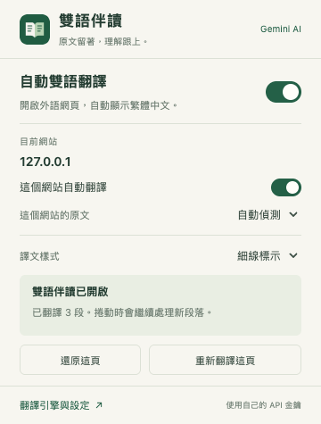

# 雙語伴讀

開啟外文網頁，繁體中文譯文自動出現在原文段落下方。Chrome 工具列上的小視窗可切換開關、暫停單一網站及調整樣式；閱讀時不必開著側邊欄，也不必逐頁按翻譯。

**Gemini 免費額度優先，免月訂閱。** 每位使用者自行設定 API 金鑰；本專案不提供共用金鑰或代付服務。Gemini 的免費額度、可用地區與限制依 Google 帳戶及 API 專案而定，不能保證永久零費用。若專案已啟用計費，API 呼叫仍可能產生費用。[Google 官方計費說明](https://ai.google.dev/gemini-api/docs/pricing)

[下載最新版](https://github.com/penny1985/bilingual-reader/releases/latest) · [隱私說明](PRIVACY.md) · [參與開發](CONTRIBUTING.md)



## 安裝：4 步

1. **下載並解壓縮**最新版 ZIP，放在打算長期保留的位置。
2. 使用桌面版 Chrome，開啟 `chrome://extensions`，打開右上角的「開發人員模式」。
3. 按「載入未封裝項目」，選取解壓縮後的 **`extension` 資料夾**，也就是含有 `manifest.json` 的那一層。
4. 在初次設定選擇 Gemini，前往 [Google AI Studio](https://aistudio.google.com/apikey) 建立自己的 API 金鑰，填入「API 金鑰」。可先按「測試 AI 翻譯」確認連線，再勾選雲端翻譯說明、按「儲存並啟用 Gemini」；重新整理外文文章即可自動顯示雙語。

如果初次設定未開啟，從 Chrome 工具列的拼圖圖示找到「雙語伴讀」，點「翻譯引擎與設定」。可將擴充功能釘選，之後調整比較方便。直接以檔案方式打開 `popup.html` 或 `setup.html` 不會安裝擴充功能。

目前以 Chrome 138 以上桌面版為基本支援範圍。Chrome 本機引擎還受裝置、模型與語言組合支援情況影響。[Chrome 官方載入教學](https://developer.chrome.com/docs/extensions/get-started/tutorial/hello-world#load-unpacked)

## 選擇翻譯引擎

| 引擎 | 適合情境 | 費用與設定 |
| --- | --- | --- |
| **Gemini，建議先用** | 想用 AI 閱讀一般文章，優先使用免費額度 | 填入自己的 Gemini API 金鑰；免費額度受帳戶、專案及配額限制 |
| Chrome 本機 | 希望待翻譯文字留在電腦，或不設定 API 金鑰 | 首次需下載支援的語言模型；無本套件的 API 用量費 |
| DeepSeek | 已有 DeepSeek API，或願意按實際用量付費 | 填入自己的 DeepSeek API 金鑰，依官方規則計費 |

Gemini 預設提供 Gemini 3.8 Flash，另可選 Gemini 3.5 Flash-Lite；DeepSeek 可選 Flash 或 V4 Pro。模型名稱、供應狀態與價格可能調整，使用前以服務商為準。[Gemini 模型與計費](https://ai.google.dev/gemini-api/docs/pricing)、[DeepSeek 模型與計費](https://api-docs.deepseek.com/quick_start/pricing)

為減少免費層級的短時間限速，Gemini 3.8 Flash 的請求起始至少間隔 13 秒，Gemini 3.5 Flash-Lite 至少間隔 4.3 秒；文章會逐段顯示譯文。這是套件的節流設定，實際每分鐘、每日與文字用量配額仍依模型及 Google API 專案而定，請以 [AI Studio 的額度頁面](https://aistudio.google.com/usage?tab=rate-limit) 為準。

切換引擎需要自行選擇。配額用完、金鑰失效或翻譯出錯時，套件會顯示狀態，**不會偷偷改接其他付費引擎**。本套件不會替你開通任何 API 帳單。

選擇 Chrome 本機引擎時，按「使用本機翻譯」，並在設定準備所需的來源語言。模型準備完成後，可關閉設定頁；模型備妥且可用時，翻譯在這台電腦運算。切換引擎後，已開啟的文章可重新整理，或按「重新翻譯這頁」。

## 日常使用

- 開啟一般 HTTP／HTTPS 外文網頁，接近閱讀位置的段落會自動翻譯，捲動與動態新增的內容會繼續處理。
- 目標語言為台灣繁體中文，原文保留；繁體中文頁面通常會略過。
- 工具列可關閉全部自動翻譯，或只暫停目前網站。
- 「還原這頁」移除譯文並暫停這頁；「重新翻譯這頁」可再試一次。
- 原文語言偵測不理想時，可指定目前網站的來源語言；譯文可選細線或柔和底色。

更新時，將新版解壓縮到固定資料夾，在 `chrome://extensions` 對「雙語伴讀」按重新載入，再重新整理文章。若改用另一個資料夾載入，請停用舊副本，避免同時翻譯。

## 台灣繁體與用語校正

3.0.2 起，Gemini、DeepSeek 與 Chrome 本機譯文都會在顯示前，使用隨套件提供的 OpenCC 台灣詞庫做離線校正。例如「数据集 → 資料集」「服务器 → 伺服器」「软件 → 軟體」「网络 → 網路」。AI 提示詞也要求台灣慣用語；網址、程式碼與檔案路徑等技術文字保留原樣。

校正不會新增翻譯請求，不使用 CDN，也不會把文字送到其他服務。詞庫不能取代語意判斷，例如物理的「質量」不應直接換成「品質」；重要術語仍可對照保留的原文。

## 金鑰與隱私

**公開專案與下載檔不包含任何人的 API 金鑰。每個人都要自行設定自己的金鑰。** 請不要把金鑰貼進 GitHub Issue、截圖、程式碼或聊天訊息。

啟用雲端引擎並確認同意後，待翻譯的網頁段落會送到所選服務商。這也包含你已登入網站中可讀取的文章內容，請在不希望傳送內容的網站關閉自動翻譯。Google 表示 Gemini 免費層級提交的內容可能用於改善其產品；敏感內容可改選 Chrome 本機。[Google 資料使用說明](https://ai.google.dev/gemini-api/terms)

金鑰存在自己電腦的 Chrome 擴充功能儲存區，沒有額外加密；網站內容腳本無法讀取金鑰。套件沒有共用翻譯伺服器、分析追蹤或永久的網頁文字資料庫。詳見 [PRIVACY.md](PRIVACY.md)。

## 範圍與品質

本版聚焦網頁文字雙語閱讀，尚未支援 PDF、圖片 OCR 或影片字幕。Chrome 內部頁面、Chrome 線上應用程式商店、跨來源 iframe 與封閉的 Shadow DOM 等內容無法處理；輸入欄、可編輯區與程式碼會略過。特殊網站版型仍可能需要調整。

翻譯供閱讀輔助，重要的數字、否定條件與專有名詞請對照原文。此專案獨立開發，與「沉浸式翻譯」沒有關係，也未宣稱品質與其付費版本相同。

## 開發與驗證

不需要建置或安裝套件，`extension/` 就是可載入的擴充功能。使用 Node.js 20 以上可執行自動測試：

```sh
npm test
```

自動測試涵蓋引擎邏輯、取消、免費層級節流與模擬的 API 回應，共 36 項通過。另有 Chrome 本機真實模型的自動翻譯、網站開關、捲動與動態內容等驗證；雲端自動整合測試仍使用模擬回應，與以下線上實測分開記錄。

2026-10-19 以相同 6 段英文實測：Chrome 本機 Translator API 完成 6/6；Gemini 3.5 Flash-Lite 完成 6/6，API 回傳共 1,242 tokens（輸入 1,021、輸出 221）。Gemini 3.8 Flash 六次均收到 HTTP 503，沒有成功譯文，無法評估其品質。另以一個固定英文區塊驗證真實 Gemini 自動網頁翻譯：未點工具列、未開側邊欄，譯文自動出現且保留原文。測試未開通付費。

完整原文、實際譯文、耗時與限制見 [翻譯品質試讀](翻譯品質試讀.html)。該頁保留 3.0.1 時的原始回傳，沒有回寫成新版結果；長句中出現的「数据集」，在 3.0.2 會校正為「資料集」。此 6 段測試無法代表所有文章，也不能據此宣稱與其他產品的翻譯品質相當。

要測試本機示範頁，可在專案根目錄啟動 HTTP 伺服器，例如 `python3 -m http.server 8765 --bind 127.0.0.1`，再開啟 `http://127.0.0.1:8765/demo.html`。

自有程式碼採 [MIT License](LICENSE)；內含 OpenCC JavaScript 與詞庫的版本、來源及 MIT／Apache 2.0 授權，見 [第三方套件說明](extension/vendor/opencc-js/README.md)。各翻譯服務的使用仍受其服務條款規範。
